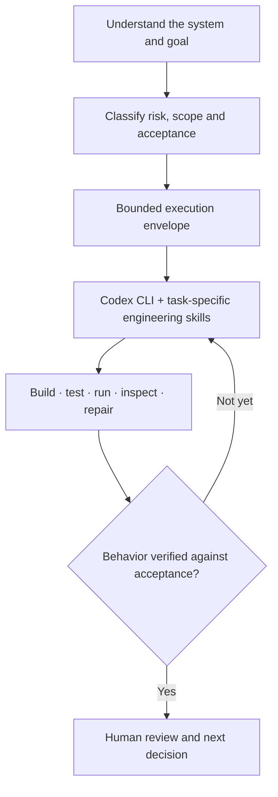

# Brian Reyes

**AI Automation & Systems Developer**  
*Automation, API-integrated systems, and agent-assisted software engineering.*

I build workflows and applications that connect business processes, data, and AI. I start by understanding the operational path: what triggers a process, which system owns each piece of data, what should be deterministic, where an AI model adds value, and how to verify the outcome.

[Portfolio](https://bri-automates.vercel.app/) · [LinkedIn](https://www.linkedin.com/in/brian-reyes-automates)

---

### What I work on

- **Automation & business systems:** event-driven workflows, CRM integrations, API/webhook orchestration, and approval or exception paths.
- **AI-enabled workflows:** LLM tool calling, retrieval-assisted processes, structured outputs, and explicit boundaries between model decisions and application logic.
- **Software & infrastructure:** web interfaces, services, databases, deployment environments, and the contracts between them.

### How I engineer

I use a **private AI Engineering Manual** to structure agent-assisted development. It separates decision-making authority from implementation, scales verification to risk, and treats observed behavior—not an agent's completion message—as the basis for acceptance.

- **Control:** clarify constraints, system ownership, acceptance criteria, and protected actions before consequential changes.
- **Execution:** use **Codex CLI** as the primary implementation agent within my **ORCA** workspace; select **Open Pstack** methods and other task-specific skills when appropriate. One execution owner is the default; delegation is bounded by the task.
- **Evidence:** inspect tests, runtime behavior, data/state changes, and failure paths. Keep implementation, verification, and release authorization distinct.

The objective isn't maximum agent autonomy. It's **useful engineering throughput with traceable decisions and reviewable results**.

### Technology stack

| Area | Tools and technologies |
| --- | --- |
| **Automation & integrations** | **n8n**, **Make**, **GoHighLevel (GHL)**, HubSpot, REST APIs, webhooks |
| **AI systems** | OpenAI API, Claude, Gemini, tool/function calling, RAG and retrieval workflows |
| **Applications** | TypeScript, JavaScript, React, Vite, Node.js |
| **Data & infrastructure** | PostgreSQL, Supabase, Docker, Linux/WSL2, Microsoft Azure, Vercel, Git/GitHub |
| **Agent-assisted engineering** | Codex CLI, ORCA, Open Pstack, custom engineering instructions and skills |

<strong>Additional tools & working environments</strong>

Activepieces · Power Automate · Microsoft 365 (SharePoint, Teams, Outlook) · Google Workspace APIs · Airtable · Pinecone · MongoDB · Metabase · Java · React Native / Expo · Cursor · Windsurf · NVIDIA NIM · OpenRouter · Ollama

These are supporting tools I have used or explored to different depths—not a claim of equal proficiency with every technology.

---

**Engineering principle:** Keep systems useful, understandable, and verifiable. When something works, be able to explain *why*—and show what was actually checked.
